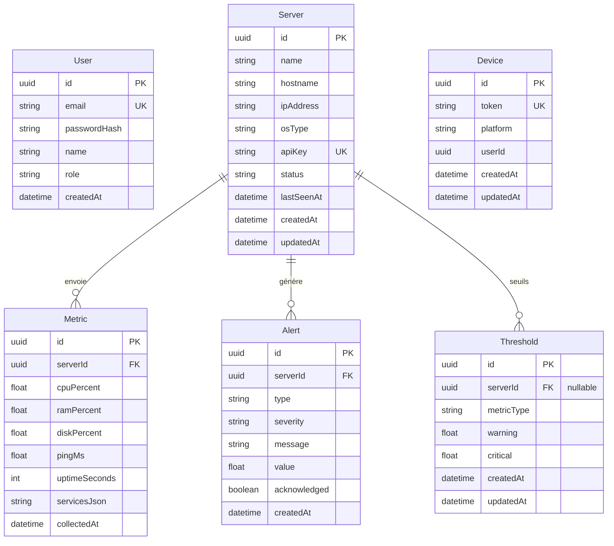

# Schéma visuel — Base de données PostgreSQL (NetWatch)

## Diagramme entité-relation (Mermaid)

Copie ce bloc sur [https://mermaid.live](https://mermaid.live) → **Export PNG/SVG** pour Word.



## Légende des relations

| Relation | Signification |
|----------|---------------|
| Server → Metric | 1 serveur, N métriques (historique CPU/RAM/disque) |
| Server → Alert | 1 serveur, N alertes |
| Server → Threshold | 1 serveur, 0..N seuils (null = global) |
| User | Comptes administrateurs (JWT) |
| Device | Tokens push mobile (FCM optionnel) |

## Statuts serveur (`Server.status`)

`pending` · `online` · `warning` · `critical` · `down`

## Types d'alerte (`Alert.type`)

`CPU_HIGH` · `RAM_HIGH` · `DISK_HIGH` · `SERVICE_DOWN` · `SERVER_DOWN`

## Index principaux

- `Metric(serverId, collectedAt)`
- `Alert(serverId, createdAt)`
- `Threshold(serverId, metricType)`
- `Server(apiKey)` UNIQUE

## Vue d'ensemble (architecture données)

```
┌─────────┐     ┌──────────┐     ┌─────────┐
│  User   │     │  Device  │     │Threshold│
└─────────┘     └──────────┘     └────┬────┘
                                      │ serverId?
                                      ▼
                               ┌──────────────┐
                               │    Server    │
                               └──────┬───────┘
                    ┌────────────────┼────────────────┐
                    ▼                ▼                ▼
              ┌─────────┐     ┌─────────┐     (seuils)
              │ Metric  │     │  Alert  │
              └─────────┘     └─────────┘
```
