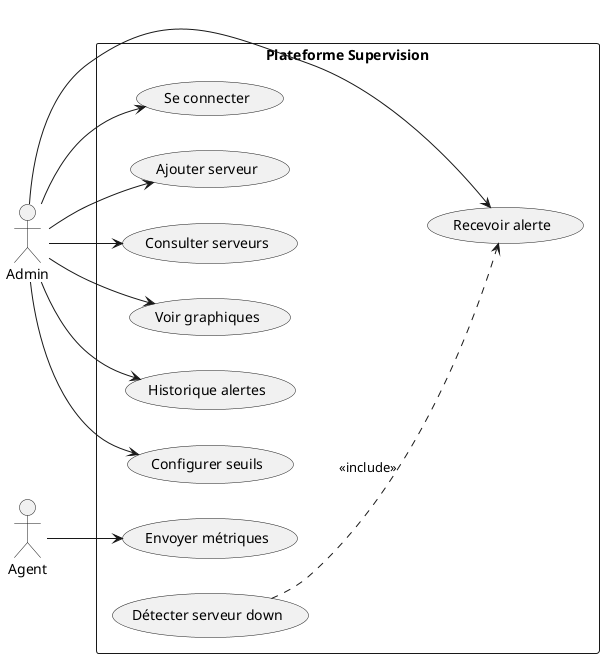
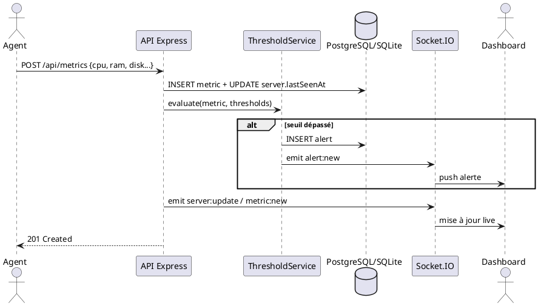
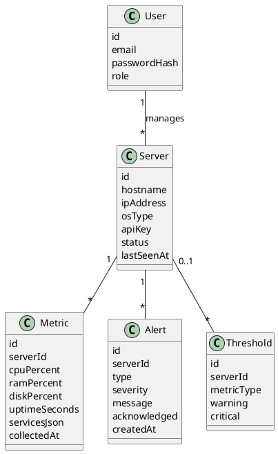

# Cas d'utilisation

## UC01 — Connexion administrateur
- **Acteur** : Administrateur
- **Précondition** : Compte créé
- **Flux** : Saisie email/mot de passe → JWT → accès dashboard/API

## UC02 — Ajout d'un serveur
- **Acteur** : Administrateur
- **Flux** : Formulaire (hostname, IP, OS, clé agent) → enregistrement BDD → statut `pending` jusqu'à première métrique

## UC03 — Collecte et envoi de métriques
- **Acteur** : Agent
- **Flux** : Lecture CPU/RAM/disque/uptime/services → POST `/api/metrics` avec API key → stockage → évaluation seuils

## UC04 — Réception d'une alerte
- **Acteur** : Administrateur
- **Flux** : Seuil dépassé ou serveur down → création alerte → événement Socket.IO → affichage dashboard + notif mobile

## UC05 — Consultation liste des serveurs
- **Acteur** : Administrateur
- **Flux** : GET `/api/servers` → pastilles vert/orange/rouge selon statut

## UC06 — Consultation détail serveur (graphiques)
- **Acteur** : Administrateur
- **Flux** : Sélection serveur → historique métriques → courbes CPU/RAM/disque

## UC07 — Consultation historique des alertes
- **Acteur** : Administrateur
- **Flux** : Page alertes filtrable (sévérité, serveur, date) → acquittement optionnel

## UC08 — Configuration des seuils
- **Acteur** : Administrateur
- **Flux** : Modification seuils warning/critical → persistance → prise en compte immédiat

## UC09 — Détection serveur injoignable
- **Acteur** : Système
- **Flux** : Job périodique → si `lastSeenAt` trop ancien → statut `down` + alerte `SERVER_DOWN`

## Diagramme de cas d'utilisation (PlantUML)

## Diagramme de séquence — flux agent → backend → dashboard

## Diagramme de classes (simplifié)

